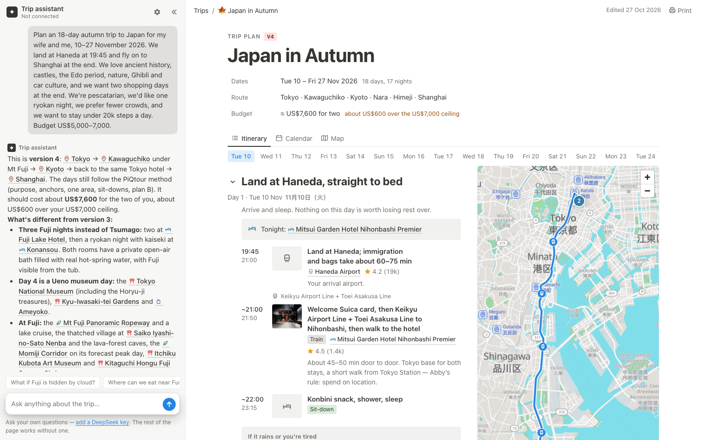
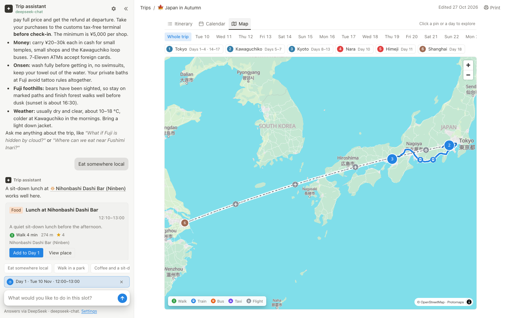
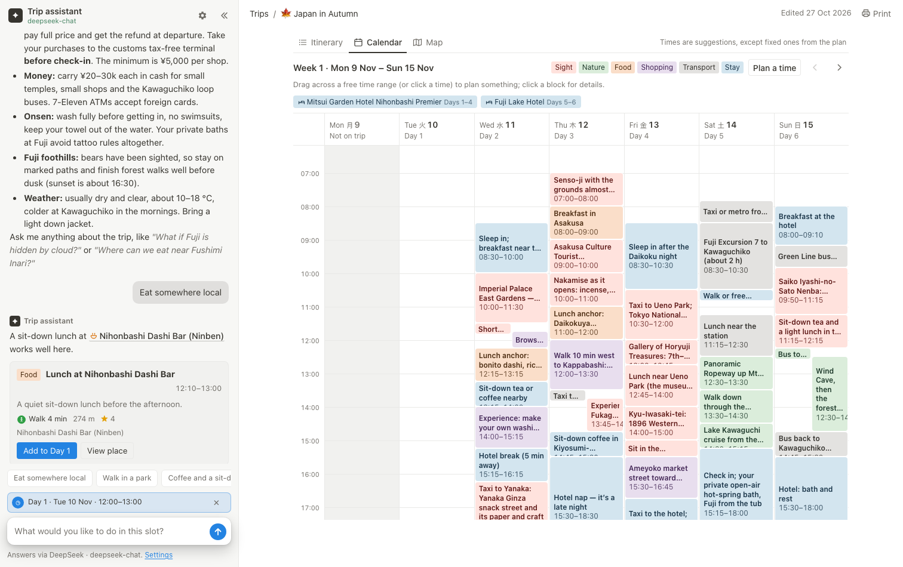
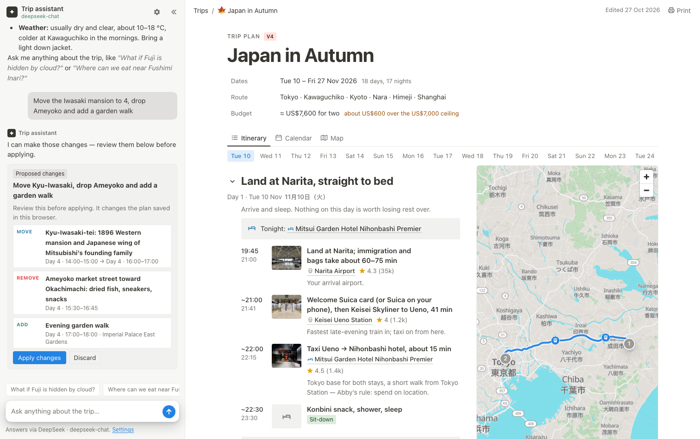
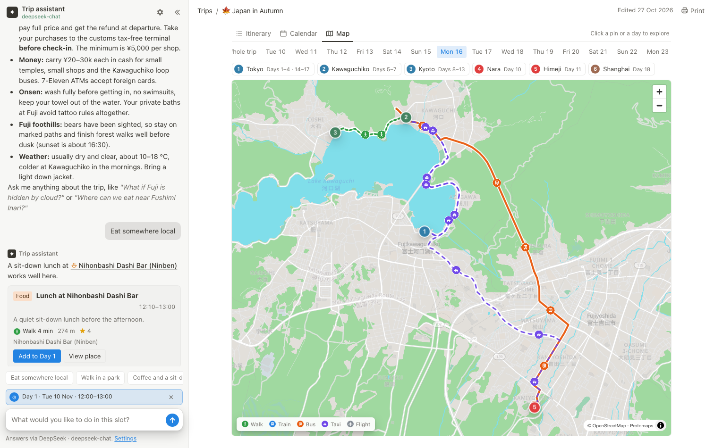

# Japan in Autumn

A private, self-contained trip site for **10–27 November 2026**: an 18-day plan through Tokyo,
Kawaguchiko, Kyoto, Nara, Himeji and Shanghai. The itinerary, calendar, map, photo panels and
trip assistant all run in the browser.



The calendar, map and place panels are at the same URL; the map uses local tiles and the
assistant can plan a selected time slot:





In normal chat the assistant can also propose moves, edits and removals; the card is only a
proposal until you press **Apply changes**:



Day routes follow the real roads and rail lines, with a different colour and icon for each mode:



## Start it

You need **Node.js 18 or newer** — nothing else. There is no install step and no API key required
to browse the trip.

```bash
cd japan-in-autumn
npm start
```

The site opens at <http://127.0.0.1:4173>. Press `Ctrl+C` to stop it.

- `npm start -- --no-open` starts without opening a browser.
- `PORT=8080 npm start` uses another port.
- If 4173 is busy, the server tries the next free port and prints the URL.

Open the site through this server, not by double-clicking `index.html`. The map is stored as
PMTiles archives that need HTTP Range requests, and the browser needs an HTTP origin to load the
local map fonts and photos.

## The trip assistant

The assistant is powered by **DeepSeek** using a key you provide. It is not connected by default.

1. Click the gear next to **Trip assistant**, or the **add a DeepSeek key** link under the composer.
2. Paste a key from [platform.deepseek.com](https://platform.deepseek.com/api_keys).
3. Choose `deepseek-chat` (fast, cheap) or `deepseek-reasoner` (slower, more careful), then **Save key**.

The key is stored in this browser's `localStorage` and is sent only to `api.deepseek.com` when you
ask a question. There is no server-side secret and no analytics. **Remove key** deletes it.

### Plan a time from the calendar

- Drag down a column (or click a time) to select a period. On a phone, tap a time.
- **Plan a time** in the calendar toolbar opens the same planner with a day picker, if you would
  rather type the day and times.
- Type what you want — “eat somewhere local”, “walk in a park”, “coffee”, “something indoors” —
  and the assistant receives the selected day, times, your previous and next stops, and a shortlist
  of nearby places with walking/transit estimates.
- Its answer comes with a **plan card** showing the place, times, rating and the **real route and
  travel time** from where you will be. Nothing is added until you press **Add to Day N**.
- If the selected period overlaps an existing activity, the planner says so before you ask.

### Change the plan in chat

Ask normally: “move the Ueno museum to the morning”, “drop Ameyoko”, “make Day 9 lunch later”,
“add a garden walk on Day 4 at 17:00”. The assistant replies with a **Proposed changes** card
listing every add, move, edit or remove with the old and new day/times. Nothing is applied until
you press **Apply changes**; **Discard** leaves the plan untouched. The assistant is instructed
never to claim a change is already done. After applying, the **Open Day** buttons jump to the
changed day and **Show map** opens the map on that day.

The live plan, including those edits, is stored as a snapshot in this browser under
`trip-plan-v1` and appears everywhere: itinerary, calendar, map, assistant context and print.
Clear that storage key to return to the original `data.js` plan.

Each question sends the trip plan, the current itinerary and the place catalogue to DeepSeek
(roughly 20k input tokens). DeepSeek caches the repeated prefix, so follow-up questions are
cheaper. The answers use the same place chips, photo previews and map/day actions as the rest of
the page.

Without a key, the page still works: the seeded plan conversation, all photos, the itinerary,
calendar, map and place panels are available. Only live questions are disabled.

## What is on the page

- **Itinerary** — all 18 days, with times, places, photos, ratings, “if it rains” alternatives,
  budget notes and warnings. Click any place name or thumbnail for photos and details.
- **Calendar** — one week at a time on desktop, one day at a time on phones. Overlapping events
  are laid out in lanes; all-day items (hotels, flights) stay in a bar above the grid. Click a
  block to open the place or jump to the day.
- **Map** — local OpenStreetMap/Protomaps vector tiles plus **real route geometry**. Walking and
  driving use OSRM; trains, buses, subways and ferries use Transitous and include the walk to and
  from the station. Routes are drawn as coloured lines with a walking, train, bus, taxi or plane
  icon along them, and a legend in the corner. The whole-trip view clusters nearby stops and lists
  them above the map; day views number the stops in order. Click a stop in the list to fly there,
  a numbered pin for the place, or a cluster to zoom in.
- **Place panel** — photos, Google rating, address, a transit link from the previous stop, and
  every day it appears in the plan.
- **Print** — the Print button (or `Cmd/Ctrl+P`) prints the complete itinerary with all days
  expanded, without the sidebar, map or photos.
- **Deep links** — the URL keeps the view: `#day-9`, `#calendar`, `#map`, `#place-kiyomizu`.
  Reloading or sharing the link restores it.

## Files

```
index.html            page shell and accessible markup
assets/app.css        all styles, including dark mode and print
assets/app.js         itinerary, calendar, map, place panels, slot selection
assets/assistant.js   DeepSeek settings, streaming chat, slot planner, plan cards
assets/routing.js     real routes and times via OSRM + Transitous, local cache
assets/data.js        window.TRIP_DATA — all trip content
assets/favicon.svg
icons/                walk, train, bus, taxi and flight route badges
img/                  653 photos, WebP (originals were 98 MB of JPEG; now ~54 MB)
tiles/                14 PMTiles archives (≈73 MB) for the offline map
fonts/, sprites/      map glyphs and sprite sheets
vendor/               MapLibre GL, PMTiles and Protomaps basemaps (local, no CDN)
server.mjs            zero-dependency static server with Range support
```

## Editing the trip

Everything the page renders comes from `assets/data.js`:

- `meta` — title, version, dates, edited date, budget, route.
- `days` — 18 day objects: `d`, `date`, `title`, `city`, `stay`, `purpose`, `items`, `planB`,
  `alts`, `spend`, `watch`. Each item has `s`/`e` (start/end), `t` (title), optional `p` (place id),
  `n` (note), `c` (kind), `k` (label such as “Sit-down”), `allDay`, `approx`.
- `places` — 146 places keyed by id. Photos are paths under `img/`; `photoSizes` maps each image
  to `[width, height]` so the browser can reserve space. If you add a photo outside the existing
  set, its size is optional but recommended.
- `plan` — the markdown used by the assistant.
- `chat` — the seeded onboarding conversation.
- `trip` — stops, route and day trips for the map.
- `regions` — map regions and the zoom at which each loads.

Place mentions in the plan and chat use `{{place-id}}`; the page turns them into chips. This is
also what the assistant is told to produce.

The live plan is saved in `localStorage` under `trip-plan-v1`, including AI additions, moves,
edits and removals. `data.js` remains the original source and is not rewritten. If you edit
`data.js` after making changes in the app, clear `trip-plan-v1` (site data) to see the new source.

## Routes and the network

The map tiles work offline. Route geometry and travel times are fetched the first time a day is
viewed (OSRM for walking/taxi, Transitous for transit) and cached in `localStorage`, so the same
day opens instantly afterwards. Without a connection, an unrouted leg is drawn as a dashed
straight line and the map says so. A routable bus leg falls back to the road geometry rather than a
straight line.

The public services are shared and rate-limited; the app queues transit requests and caches
results. For a production trip used by many people, use your own OSRM/OpenTripPlanner instance or
a keyed provider.

Photos and ratings came from Google Maps in October 2026 and are used here for a private trip.
Map data is © OpenStreetMap contributors (ODbL) and © Protomaps.

## Deploying

The site is plain static files; `server.mjs` is only a local convenience. Upload the folder to
Netlify, Vercel, Cloudflare Pages or GitHub Pages. Those hosts support Range requests, so the
map works. The assistant keeps using the browser-held key, so no server function is needed.

If you deploy somewhere that does not support Range requests, the map still loads but downloads
whole PMTiles archives instead of slices.

## Credits

- [MapLibre GL JS](https://maplibre.org/) and [PMTiles](https://github.com/protomaps/PMTiles)
- [Protomaps basemaps](https://protomaps.com/) and OpenStreetMap contributors
- [OSRM](https://project-osrm.org/) and the OpenStreetMap DE routing service for walking/driving
- [Transitous](https://transitous.org/) (MOTIS) for public-transport itineraries and stop data
- Photos, ratings and review snippets: Google Maps, collected October 2026
- Trip content and design: the original Japan in Autumn plan (V4, 27 Oct 2026)
